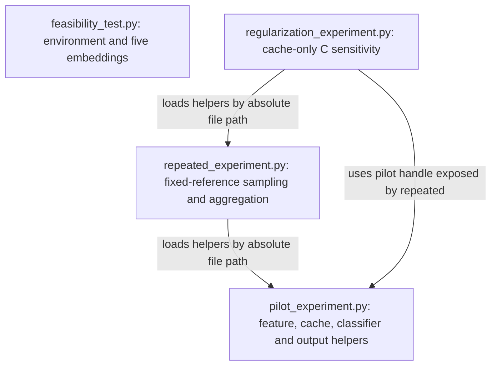

# Architecture and data flow

## Scope and entry points

NewsRepLab compares feature representations while keeping the classifier family
and labeled samples controlled. The four standalone Spyder scripts remain the
architecture; there is no package framework, trainer class, or new CLI layer.

The arrows describe helper access, not automatic experiment execution. Importing
a module defines constants/functions and imports dependencies; it does not call
`main()`, fit a classifier, download a model, or execute CUDA. Direct file imports
support F5 and avoid reliance on Spyder's current working directory. A fresh helper
module is loaded on rerun rather than reusing stale settings from `sys.modules`.

`feasibility_test.py` stays independent so the early environment check does not
depend on the classifier/plotting workflow. Repeated and regularization experiments
already reuse pilot functionality. Small duplicated setup/identity calculations
are retained where extraction would obscure the protocol or cache-miss guard.

## Data to prediction

1. **Load and identify data.** Supervised scripts request only the pinned AG News
   training split. A label vector of shape `(120000,)` supports class-balanced
   sampling without tokenizing all news. Row IDs refer to the original split.
2. **Reserve validation.** The pilot reserves 200 examples per class first. Its
   800 ordered validation row IDs remain fixed in later rounds. Training subsets
   contain 25 or 100 examples per class; the smaller set is nested in the larger.
3. **Select text.** `select_rows` returns an ordered list of `n` strings and an
   integer target array of shape `(n,)`. Both representations receive the same
   ordered rows and labels. Label alignment is part of the design, not incidental.
4. **Extract features.** `tfidf_features` fits on training text and transforms
   validation, returning sparse matrices `(n_train, vocabulary_size)` and
   `(800, vocabulary_size)`. Vocabulary size is at most 20,000 and can change with
   the training subset. MiniLM produces dense normalized float32 matrices
   `(n_train, 384)` and `(800, 384)`. Labels are not encoder inputs.
5. **Fit the classifier.** For either numeric matrix, Logistic Regression learns
   four coefficient vectors and four intercepts: shapes `(4, d)` and `(4,)`.
   Linear scores become softmax probabilities `(800, 4)`. Standard cross-entropy
   with L2 regularization is optimized by scikit-learn, not a custom training loop.
6. **Evaluate.** Argmax over class probabilities produces `(800,)` predictions.
   Accuracy measures overall correctness. Macro-F1 averages the four class F1
   scores equally. Validation targets are used for evaluation, never `fit()`.
7. **Record.** Timestamped folders receive metrics, diagnostics, settings,
   provenance, figures, and local prediction/error files. Failed runs retain a
   `failed` status and must not be represented as completed experiments.

## Responsibilities

| Module | Main responsibilities |
| --- | --- |
| Feasibility | CUDA tensor probe; split sizes; five training texts; shape/finite checks |
| Pilot | Protocol constants; sampling; training-only TF-IDF; embedding cache integrity; classifier fitting; diagnostics and serialization |
| Repeated | Validate pinned pilot; preserve seed-42 rows; draw other training subsets outside validation; aggregate 12 cells and paired differences |
| Regularization | Validate pinned repeated reference; read four existing embedding blocks; refit TF-IDF once per seed; verify C=1 before other C values; aggregate 18 cells |

## Frozen features and caching

`model.eval()` disables training-mode behavior; disabling gradients and using
`torch.inference_mode()` express frozen extraction. There is no Transformer
optimizer or backward pass. CUDA is synchronized at timing boundaries.

Cache identities include ordered text hashes and row IDs, pinned revisions,
dataset fingerprint, encoding settings, device/CUDA details, and package versions.
The loader checks shape, finite floating values, identity, array checksum, and
timing metadata. A hit returns historical extraction time separately from current
cache I/O. Validation features can also be reused in memory without counting
their compute twice. Concurrent cache writers are unsupported.

Round 3 independently checks the recorded key and the existence of both cache
files before calling the pilot helper with `model=None`. A miss must fail, not
silently run an encoder. Cross-machine reproduction is limited by this strict
identity, as explained in [reproducibility](reproducibility.md).

## Reproducibility boundaries

Sampling seed, classifier `random_state`, and encoder setup seed have distinct
roles. Sampling seeds vary the labeled examples; L-BFGS keeps its original
`random_state=42` setting. All seeds share the same validation set. Their SD is
descriptive variation, not uncertainty across independent held-out datasets.

The feasibility script is unpinned and illustrative. Supervised scripts pin
dataset/model revisions and record software versions. This maintenance pass
preserves algorithm expressions, RNG order, hyperparameters, paths used for
reference selection, and cache schema. New source hashes reflect formatting and
documentation edits; historical code hashes in saved metadata remain untouched.
